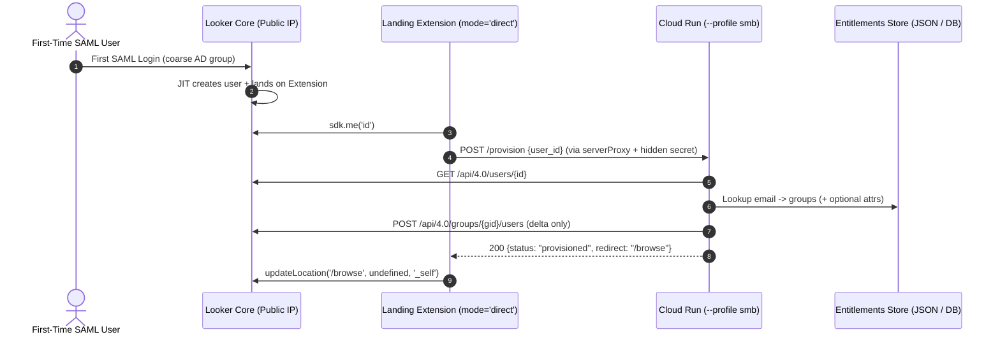
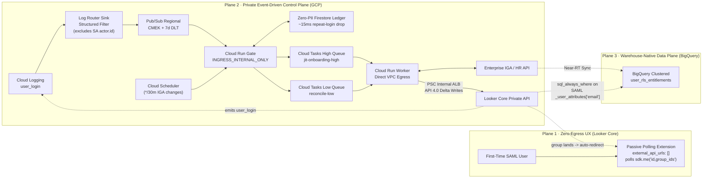

# Architecture Guide: SMB & Enterprise Profiles

This repository uses a single unified backend (`backend/`) and a single dual-mode Looker Extension (`extension/`) to serve two deployment profiles.

---

## 1. SMB / Mid-Market Profile (`mode: 'direct'`, `--profile smb`)

Designed for teams of ~50–1,000 users on Public IP Looker Core that want fast setup with minimal cloud infrastructure.



### Key Properties
- **Single container**: `infra/smb/` deploys one Cloud Run service (`max_instances = 2`, `LOOKER_MAX_CONCURRENCY = 10`) and three Secret Manager secrets (`looker-client-id`, `looker-client-secret`, `shared-secret`).
- **Authentication**: In production, set `transport: 'server'` in `extension/src/config.js` so Looker's `serverProxy` injects `X-Provisioning-Secret` from a hidden scoped user attribute (`createSecretKeyTag`). Browsers never see the secret.
- **Short-lived replay cache**: `App.provision_direct()` caches successful outcomes in memory (default 300 s) so accidental refreshes do not burn extra Looker API calls.

---

## 2. Enterprise Profile: Converged 3-Plane Hybrid (`mode: 'passive_poll'`, `--profile gate` + `--profile worker`)

Designed for 1,000–50,000+ users, Private IP / PSC Looker Core instances, VPC Service Controls, CMEK, and high-cardinality RLS/CLS governance.



### Plane 1: Zero-Egress UX (`extension/`, `manifest.enterprise.lkml`)
- Declares **`external_api_urls: []`**. The Extension never sends a browser request or server-proxy call outside Looker, eliminating CORS, browser secret handling, and Private IP PSC Southbound egress infrastructure.
- On load, captures optional `?next=/dashboards/123` (strictly validated as an internal relative path) and polls `sdk.me('id,group_ids')` on a jittered backoff schedule (`[2500, 4000, 7000, 12000, 20000]` ms).
- Three deterministic outcomes:
  1. **Provisioned**: Any group appears outside `ignoredGroupIds` and `pendingMarkerGroupId` (or matches explicit `provisionedGroupIds`) -> auto-redirects to `?next=` or `hubPath` (default `/browse`).
  2. **Pending / No Entitlements**: `pendingMarkerGroupId` (`BI_Access_Pending_Approval`) appears -> stops polling immediately and renders a friendly "No dashboards assigned yet" screen with an optional self-service IT/IGA request link (`accessRequestUrl`).
  3. **Timeout**: After backoff exhausts (~45 s), renders a manual **Check Again** button so the user is never stranded.

### Plane 2: Private Event-Driven Control Plane (`backend/`, `infra/enterprise/`)
1. **Structured Log Capture**: `google_logging_project_sink` filters on `resource.type="looker.googleapis.com/Instance"`, exact `logName`, non-empty `jsonPayload.actor.id`, and deterministic exclusion of `provisioning_sa_looker_user_id` (no brittle free-text regex on `message`).
2. **Regional Pub/Sub + 7-Day Dead-Letter Topic**: Regional storage policy (`allowed_persistence_regions = [var.region]`), optional CMEK (`kms_key_name`), and a 7-day pull replay subscription on the DLT so transient outages never drop onboarding events.
3. **Cloud Run Gate (`--profile gate`) + Zero-PII Firestore Ledger**:
   - Cloud Run ingress is set to `INGRESS_TRAFFIC_INTERNAL_ONLY` (GCP allows same-project / VPC-SC Pub/Sub push, Cloud Tasks, and Cloud Scheduler over the internal Google network).
   - `FirestoreRestLedger` stores documents keyed by `looker_user_id` containing **only** non-PII fields: `status`, `entitlement_hash` (SHA-256 of sorted target groups & attributes), `lease_until_ms`, `updated_at_ms`, and `last_outcome`. **No emails, names, or group names are written to Firestore.**
   - Repeat logins within `LEDGER_FRESH_TTL_S` (default 24 h) return `action: "skip_fresh"` in ~15 ms with **0 Looker API calls**.
   - Concurrent duplicate login events within `LEDGER_LEASE_TTL_S` (default 60 s) are deduplicated via Firestore `currentDocument` CAS preconditions (`action: "skip_in_flight"`).
4. **Dual Priority Cloud Tasks Queues**:
   - `jit-onboarding-high` (`6 tasks/s`, `10 concurrent`): Protects Day-1 user logins during Monday-morning spikes (~15–20 Looker API calls/s across 2–3 calls/user).
   - `reconcile-low` (`2 tasks/s`, `2 concurrent`): Completely isolates background IGA revocations and entitlement updates so batch changes never delay live users.
5. **Cloud Run Worker (`--profile worker`)**:
   - Uses **Direct VPC Egress** (`PRIVATE_RANGES_ONLY`) to reach Looker Core's Private IP / PSC Northbound Internal ALB and the private Enterprise IGA API.
   - Maintains a 50-minute Looker API 4.0 access-token cache (re-authenticating proactively before 60-minute expiry), a per-container concurrency semaphore (`LOOKER_MAX_CONCURRENCY`), and `Retry-After` backoff for HTTP 429/503.
   - **Fail-closed safety**: Refuses to provision non-SAML accounts when `REQUIRE_SAML=true`, refuses to touch service accounts (`is_service_account`), assigns `BI_Access_Pending_Approval` when IGA returns no entitlements, and only revokes groups matching `MANAGED_GROUP_PREFIX` (e.g., `BI_`) or explicit `MANAGED_GROUPS`—never `All Users` or `externally_managed` SAML groups.

### Plane 3: Warehouse-Native Data Plane (`sql/`, `lookml/warehouse_rls.example.lkml`)
- High-cardinality RLS/CLS (cost centers, regions, legal entities, accounts) belongs in the data warehouse, not in Looker User Attributes.
- `sql/bigquery_rls_entitlements.sql` creates a clustered table keyed by `user_email`.
- `lookml/warehouse_rls.example.lkml` enforces `sql_always_where` using Looker's built-in SAML attribute `{{ _user_attributes["email"] }}`.
- **Result**: 0 Looker Admin API calls for RLS, 0 ms cold-start lag even on direct deep links, and immediate revocation on the next query after IGA updates BigQuery.

---

## 3. Looker Core Admin API Call Budget

Looker (Google Cloud core) editions include monthly Admin API call entitlements (logins do not count; user/group/attribute reads & writes do):

| Looker Core Edition | Included Monthly Admin API Calls |
| --- | --- |
| Standard | 1,000 / month |
| Enterprise | 10,000 / month |
| Embed | 100,000 / month |

### How This Architecture Minimizes Admin API Consumption
1. **Zero Looker API calls on repeat logins**: Firestore ledger drops returning users at the Gate.
2. **Group-ranked `landing_page` (`NO_LANDING_PAGE=true`)**: Saves 1 Admin API call per user by letting Looker group precedence override the coarse onboarding landing page.
3. **Warehouse-native RLS**: Saves $N$ user-attribute write calls per user (typically 5–15 calls/user).
4. **Nested persona groups**: Assigning 1 persona group (that nests regional/functional sub-groups) instead of 5–10 flat groups cuts group-add calls dramatically.
5. **Change-feed reconciliation**: Cloud Scheduler queries `GET /changes?since=<cursor>` from IGA and only touches changed users—never scanning all 10,000 users in Looker.

| Scenario (10,000-user rollout) | Calls / New User | Total Month-1 Admin Calls |
| --- | --- | --- |
| Naive (per-user landing page + 5 flat groups + 5 RLS attrs) | ~13 calls | ~130,000 calls |
| **This architecture** (1 `GET /users/{id}` + 1–2 nested persona `add_group_user` + group-ranked landing page + BQ RLS) | **2–3 calls** | **~20,000–30,000 calls** (and ~1–2K/mo steady state) |

> **Planning tip**: For a 10,000-user initial rollout on Enterprise edition (10K included/mo), either stagger cohort onboarding across 2–3 months or plan for API overage / Embed tier during Wave 1.

---

## 4. Enterprise IGA REST Contract (`backend/entitlements.py`)

When `IGA_BASE_URL` is configured, `HttpIgaEntitlements` expects two HTTPS endpoints authenticated with `Authorization: Bearer <IGA_BEARER_TOKEN>`:

### `GET <IGA_BASE_URL>/entitlements?email=<url-encoded-email>`
- **`200 OK`**:
  ```json
  {
    "groups": ["BI_Dashboard_Hub", "BI_EMEA_Finance"],
    "landing_page": "/browse",
    "user_attributes": {}
  }
  ```
- **`404 Not Found`**: Treated as "no entitlements" (Worker assigns `PENDING_MARKER_GROUP`, e.g., `BI_Access_Pending_Approval`).
- **`5xx` / Timeout**: Raises `EntitlementsError` -> Worker returns HTTP 503 so Cloud Tasks retries with exponential backoff.

### `GET <IGA_BASE_URL>/changes?since=<opaque-cursor>`
- **`200 OK`**:
  ```json
  {
    "emails": ["alice@example.com", "bob@example.com"],
    "next_cursor": "2026-11-27T04:30:00Z"
  }
  ```
- Called periodically by Cloud Scheduler -> `POST /tasks/reconcile`. Only changed users are looked up in Looker (`search_users_by_email`) and enqueued to `reconcile-low` with `revoke: true`. The cursor is persisted atomically in Firestore (`__reconcile_cursor__`).
